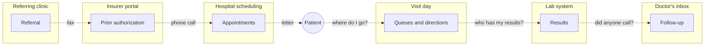
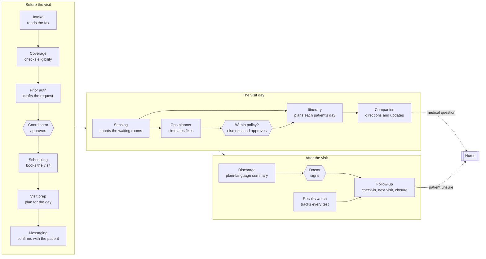
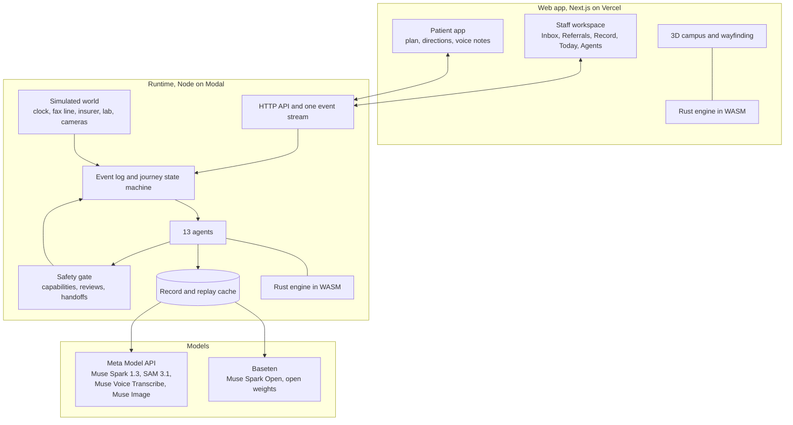
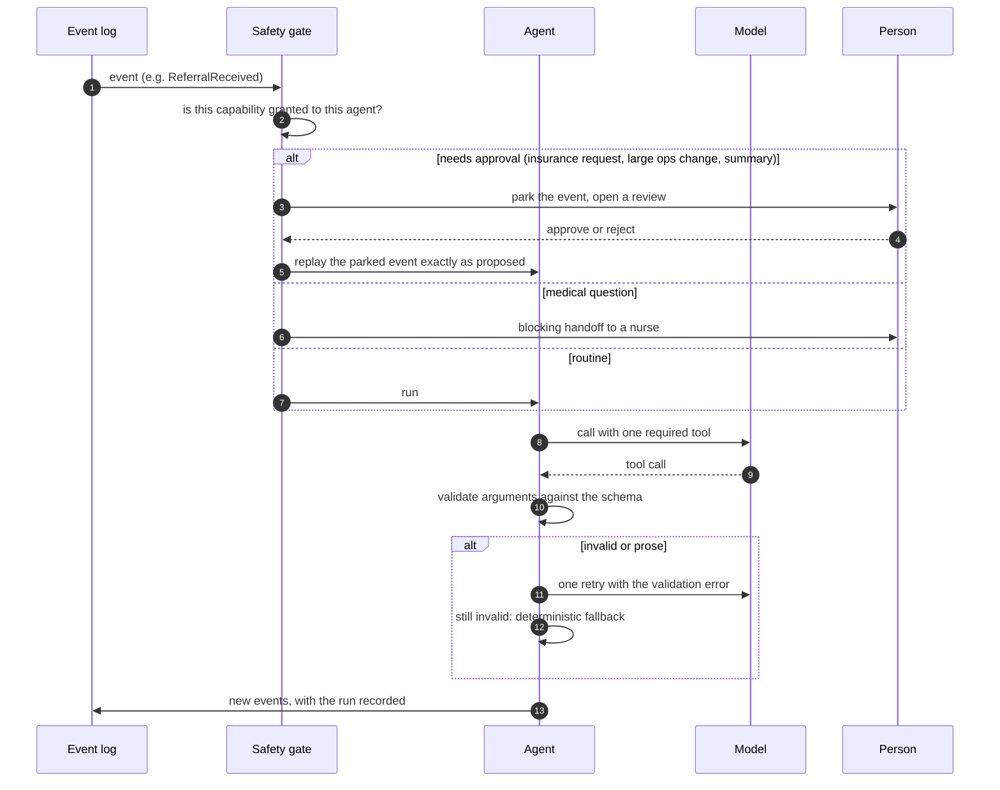

# Throughline

**One thread through a hospital visit.** Thirteen AI agents carry the routine work around a patient's care, from the faxed referral to the follow-up, and bring in a person whenever a human has to decide.

Built for the Meta Global AI Developer Hackathon (Oct 27 to Nov 4, 2026).

- **Live app:** https://throughline-zeta-ten.vercel.app
- **Code:** https://github.com/hungtruongOwolf/throughline
- **Demo script:** [`docs/DEMO-SCRIPT.md`](docs/DEMO-SCRIPT.md)

> Throughline is administrative software. It never diagnoses, triages, interprets results, or gives medication advice. A medical question always goes to a nurse.

## Contents

1. [The problem](#1-the-problem)
2. [Mission and vision](#2-mission-and-vision)
3. [The solution](#3-the-solution)
4. [How it works](#4-how-it-works)
5. [Meta models](#5-meta-models)
6. [Technical decisions](#6-technical-decisions)
7. [Technical difficulties](#7-technical-difficulties)
8. [Safety and boundaries](#8-safety-and-boundaries)
9. [What is real and what is simulated](#9-what-is-real-and-what-is-simulated)
10. [What's next](#10-whats-next)
11. [Run it](#11-run-it)

---

## 1. The problem

### A hospital is organized around its departments, not around the patient

A single referral for a CT scan touches a clinic, an insurer, a scheduling desk, a radiology department, a lab, and at least two doctors. Each one has its own people and its own software, and nobody owns the whole chain. The patient is the only one who walks the full path, and the patient is the one with the least information.



Every dotted arrow is a handoff done by hand: a fax, a phone call, a portal login, a sticky note. Each one is a place where a patient can fall through.

### Who it hurts most

People who have someone on the inside get through. People who don't, struggle:

- **Older patients** who are managing several appointments, a wheelchair, and a ride from family.
- **People with limited English.** About 25 million people in the US speak English "less than very well" (US Census Bureau, American Community Survey, via Migration Policy Institute).
- **People with low health literacy.** Only 12% of US adults had proficient health literacy in the last national assessment; 36% had basic or below-basic skills (NCES, National Assessment of Adult Literacy, 2003).

My family has lived this: a lost referral, weeks waiting on an insurance approval, and test results nobody called about. None of it was medical. All of it was coordination.

### The numbers in the US

| Where it breaks                 | What the research found                                                                                                                                                                 | Source                                                                                  |
| ------------------------------- | --------------------------------------------------------------------------------------------------------------------------------------------------------------------------------------- | --------------------------------------------------------------------------------------- |
| The system as a whole           | About **25%** of US health spending is estimated to be waste, $760B to $935B a year. Administrative complexity is the single largest category, at about $266B.                          | Shrank, Rogstad, Parekh, _JAMA_ 2019                                                    |
| Referrals                       | Only about **half** of specialty referrals were completed: 71% led to an appointment, and 70% of those appointments were kept.                                                          | Weiner, Perkins, Callahan, _J Eval Clin Pract_ 2010 (one academic center, older adults) |
| Insurance approval              | Practices complete about **43 prior authorizations per physician per week**, and physicians and staff spend **12 to 13 hours a week** on them.                                          | AMA Prior Authorization Physician Survey (2022 and 2024 editions)                       |
| Insurance approval, per request | A manual prior authorization (phone, fax, email) takes about **24 minutes** of staff time.                                                                                              | CAQH Index 2024                                                                         |
| The visit day                   | A typical visit takes about **two hours** of the patient's time, of which about **20 minutes** are with the clinician.                                                                  | Ray et al., _Am J Manag Care_ 2015                                                      |
| Directions                      | Hospital staff spend about **32 minutes a week** each giving directions; 46% say it distracts from their duties.                                                                        | Jamshidi et al., _HERD_ 2025 (n=301)                                                    |
| After the visit                 | **79%** of older patients discharged with a medication change misunderstood at least one change.                                                                                        | Ziaeian et al., _J Gen Intern Med_ 2012                                                 |
| Results                         | **1 in 14** clinically significant abnormal outpatient results (7.1%) was never communicated to the patient, or not documented as communicated. In some practices the rate reached 26%. | Casalino et al., _Arch Intern Med_ 2009                                                 |
| Readmissions                    | About **1 in 5** Medicare patients is readmitted within 30 days, and half of them had no office visit in between.                                                                       | Jencks et al., _NEJM_ 2009                                                              |

Some of these studies are old or cover one institution. We cite them as signals of where the chain breaks, not as today's national rates.

### The numbers worldwide

| What                     | Figure                                                                                                                                                         | Source                                                         |
| ------------------------ | -------------------------------------------------------------------------------------------------------------------------------------------------------------- | -------------------------------------------------------------- |
| Access to essential care | About **4.5 billion people**, half the world, were not fully covered by essential health services in 2021. 2025 data put it at about 4.6 billion.              | WHO and World Bank, UHC Global Monitoring Report 2023 and 2025 |
| Harm from unsafe care    | About **1 in 10** patients is harmed in health care, and more than **3 million** people die each year from unsafe care. About half of the harm is preventable. | WHO patient safety fact sheet, 2023                            |
| Primary and outpatient   | As many as **4 in 10** patients are harmed in primary and ambulatory care, and up to 80% of that harm may be avoidable.                                        | WHO patient safety fact sheet, 2023                            |

The details differ by country, but the shape is the same everywhere: care is delivered by specialized departments, and the work of connecting them falls on staff with no time and patients with no map.

### What exists today

Hospitals already buy tools for pieces of this: wayfinding apps, queue screens, prior authorization portals, patient portals, command centers. Each tool covers one department's step. We found none that follows one patient through every step and hands the work from one step to the next ([`docs/UX-RESEARCH.md`](docs/UX-RESEARCH.md)).

---

## 2. Mission and vision

**Mission.** Nobody should need someone on the inside to get through a hospital. Throughline takes the routine coordination off people's desks and connects the steps, so patients always know where to go, who to ask, and what comes next.

**Vision.** Every patient journey is one connected thread, from the first referral to the last follow-up, in any hospital. Agents carry the routine work; people make the decisions that need a person; and everyone, patient and staff, can see where the thread is.

**Principles we built by:**

1. **One journey, not separate tools.** The product is one state machine that runs from referral to closed loop. Each step leaves structured state the next step consumes, without anyone typing it again.
2. **A person at every decision that matters.** An insurance request, a doctor's summary, and any large change to the day wait for a person. Medical questions always go to a nurse.
3. **Every step can be explained.** Each agent run is recorded with its input, its source documents, the model it ran on, and what it decided.
4. **Built for the least advantaged user.** Large type, plain words, English and Spanish, step-free routes, and voice notes instead of forms.
5. **Not tied to one hospital.** Every hospital is a workspace with its own campus, buildings, floors, and staff.

---

## 3. The solution

Throughline is a patient-access and visit-day workspace for hospitals, with a separate app for patients. Thirteen agents each own one step of the journey and hand the work to the next one.

### The journey



### The thirteen agents

| Agent         | What it does                                                                                                         | Runs on                                    | Who decides                                                                       |
| ------------- | -------------------------------------------------------------------------------------------------------------------- | ------------------------------------------ | --------------------------------------------------------------------------------- |
| Intake        | Reads the faxed referral and insurance card into a structured packet. Asks the coordinator instead of guessing.      | Muse Spark 1.3 (vision, structured output) | Coordinator answers its questions                                                 |
| Coverage      | Checks eligibility and whether the service needs prior authorization.                                                | Payer rules (deterministic)                |                                                                                   |
| Prior auth    | Drafts the insurer request beside the original fax.                                                                  | Muse Spark 1.3                             | **Coordinator approves before it is sent**                                        |
| Scheduling    | Books dependent appointments into as few visit days as possible, on days the patient can travel.                     | Rust engine                                |                                                                                   |
| Visit prep    | Builds the patient's plan for the day.                                                                               | Rules                                      |                                                                                   |
| Messaging     | Sends messages and reads replies, including voice notes, in English or Spanish.                                      | Muse Voice Transcribe, Muse Spark 1.3      | Symptoms go to a nurse                                                            |
| Sensing       | Counts people in each waiting room and detects bottlenecks.                                                          | SAM 3.1                                    |                                                                                   |
| Itinerary     | Plans and replans each patient's route through the building from live waits and walking distances.                   | Rust engine                                |                                                                                   |
| Companion     | Tells the patient where they are, how long the wait is, and what's next; reads a photo of a sign when they are lost. | Muse Spark 1.3 (vision), Rust engine       | Medical questions go to a nurse                                                   |
| Ops planner   | Simulates every possible fix for a bottleneck and proposes the best one.                                             | Muse Spark Open on Baseten, Rust engine    | **Applies small changes within policy; larger ones wait for the operations lead** |
| Results watch | Tracks every test until a doctor acknowledges it.                                                                    | Rules                                      |                                                                                   |
| Discharge     | Rewrites the visit notes in plain language next to the original, and checks understanding the next day.              | Muse Spark 1.3                             | **Doctor signs before it reaches the patient**                                    |
| Follow-up     | Books the next visit, checks in with the patient, and reports back to the referring doctor.                          | Rust engine                                | An unsure patient becomes a nurse call                                            |

### What each person sees

- **Referral coordinator, Inbox:** every decision an agent parked for a person, with the draft beside its source (the fax, the payer rule, the doctor's notes) and one action.
- **Everyone, Referrals:** each patient, the stage, who holds the next move, and the next step.
- **Patient record:** a timeline of what each agent did, with the model it ran on and the full run on click.
- **Operations lead, Today:** the live floor in 3D, waits by station, the planner's proposals, and what was applied on its own and why.
- **Agents:** the 13 agents, their runs, how often they finished on their own, waited for staff, or handed off to a nurse, and their guardrails.
- **Patient app:** one plan, the next step, the wait, step-free directions, and a way to write or send a voice note.

### Three hospitals, and your own

The front page lists Halden Medical Center (the live workspace), Northgate University Hospital (five buildings, a 14-floor tower), and St. Brennan (four buildings, up to 10 floors). **Add your hospital** sets up another. Each has its own campus model, floors, and staff workspaces.

### One referral, end to end

| Phase     | What happens                                                                                                                                                                                                                                                                                                                                                                                                                                         | Who decides                                                        |
| --------- | ---------------------------------------------------------------------------------------------------------------------------------------------------------------------------------------------------------------------------------------------------------------------------------------------------------------------------------------------------------------------------------------------------------------------------------------------------- | ------------------------------------------------------------------ |
| Before    | Spark vision reads the faxed referral. The end of the member ID is smudged, so Intake asks the coordinator instead of guessing. Coverage finds the CT needs prior authorization and Prior auth drafts the request beside the fax. Once the insurer approves, Scheduling books the visits into one morning on a day the patient's daughter can drive her. She confirms by voice note; Voice Transcribe and Spark pick up that she needs a wheelchair. | The coordinator approves the insurance request                     |
| Visit day | SAM 3.1 counts people in the waiting rooms and the plans update. A CT scanner breaks down. The Rust engine runs the rest of the day 20 times for each possible fix, and Muse Spark Open writes one proposal: an extra slot on the second scanner, which cuts the average CT wait from about 17 minutes to 5. The change is small and clearly helps, so it applies within policy; the operations lead sees what changed and why.                      | Within policy it applies on its own; otherwise the operations lead |
| After     | Spark restates the doctor's notes in plain words beside the original. The next day, the Follow-up agent checks in; an unsure answer becomes a nurse call. Results are tracked until a doctor acknowledges them, the next visit is booked, and the referring doctor gets a closure report.                                                                                                                                                            | The doctor signs the summary                                       |

---

## 4. How it works

### Architecture



- **Runtime** (`apps/runtime`): a TypeScript service. Every change is an event in an append-only log; a journey's state is derived from its events. Agents subscribe to events, act through granted capabilities, and emit new events.
- **Engine** (`packages/engine`): Rust compiled to WebAssembly, so the same code runs in the server and in the browser. It does walking routes, scheduling with dependencies, queue estimates, and a discrete-event simulation of the day for what-if analysis.
- **Web** (`apps/web`): Next.js. The staff workspace, the patient app, the 3D campus, and station boards share one live event stream.
- **Simulated world** (`apps/runtime/src/sim`): the clock, the fax line, the insurer, the lab, and the waiting-room cameras, so the whole journey runs end to end without real patient data.

### The agent contract

Every agent, model-based or not, follows the same path. This is what makes 13 agents safe to run without someone watching each one.



- A **model agent must call exactly one validated tool.** It gets one retry with the validation error, and otherwise falls back to a deterministic rule. The fallback is recorded.
- **Gated actions park and replay.** The triggering event is stored; when a person approves, the same event runs again, so what was approved is exactly what happens.
- **Handoffs block.** A medical question opens a nurse task and stops any automated reply to it.

---

## 5. Meta models

| Use                                                                                                                 | Model                         | Where                         |
| ------------------------------------------------------------------------------------------------------------------- | ----------------------------- | ----------------------------- |
| Fax reading (vision, structured output), summaries, teach-back grading, patient messages, reply intent, sign photos | `muse-spark-1.3`              | Meta Model API                |
| Ops proposals (open weights)                                                                                        | `meta-models/muse-spark-open` | Baseten (switch: `OPS_BRAIN`) |
| Counting people in waiting-room frames                                                                              | `sam-3.1`                     | Meta Model API                |
| Patient voice notes                                                                                                 | `muse-voice-transcribe-1.0`   | Meta Model API                |
| The waiting-room camera frames SAM counts                                                                           | `muse-image-1.0`              | Meta Model API                |

Measured with live calls (`docs/evals/`):

- **Referral fax reading:** 10/10 runs produced a valid packet, each with the smudged ID flagged rather than guessed.
- **Clinical-question screen** on 60 clinical and 40 everyday prompts (English and Spanish): keywords catch 60/60, Spark catches 60/60, with **0** false positives.

---

## 6. Technical decisions

| Decision                                                    | Alternatives                                  | Why                                                                                                                                                                                               |
| ----------------------------------------------------------- | --------------------------------------------- | ------------------------------------------------------------------------------------------------------------------------------------------------------------------------------------------------- |
| One journey state machine across all three phases           | Separate tools per phase                      | The handoffs between phases are where patients are lost. A visit-day tool alone would be one more silo.                                                                                           |
| Administrative only; medical questions go to a nurse        | Light triage, result explanations             | A sharp boundary keeps the product clear of clinical decision-making and makes every agent's job checkable.                                                                                       |
| Event log as the source of truth                            | Mutable records                               | Every decision can be replayed and audited. A journey's whole history is one list of events.                                                                                                      |
| Park-and-replay approvals                                   | Approve by editing the record                 | The person approves the exact proposed action, and the test suite can check that what ran is what was approved.                                                                                   |
| One required tool per model call, validated in code         | Parse free text                               | The model API cannot force a tool call, so validation in code, one retry, and a deterministic fallback are what make each agent verifiable.                                                       |
| Ops planner applies small changes on its own, within policy | Every change waits for a manager              | A manager approving every one-patient swap is the same bottleneck we set out to remove. Changes that move at most 10 patients and cut the wait by at least 30% apply on their own; the rest wait. |
| Rust engine compiled to WebAssembly                         | TypeScript only; Rust on the server only      | Scheduling and the queue simulation need exact, fast, repeatable answers, and the same code runs in the browser (map, routes) and on the server (agents).                                         |
| Language models write and read; the engine computes         | Ask the model for the schedule or the numbers | Models are good at reading a fax or explaining a proposal and bad at exact arithmetic. Every number on screen comes from the engine.                                                              |
| Open-weight model for the ops planner                       | Hosted model only                             | Operations data is sensitive and hospitals want control. With open weights, a hospital can run the planner on its own hardware. Our deployment uses Baseten.                                      |
| Record-and-replay model cache                               | Live calls only; mocked outputs               | The public site serves outputs recorded from real model calls, so it works at any hour without API keys on the server, and the same run can be replayed in tests.                                 |
| Simulated clock                                             | Wall-clock timers                             | A three-phase journey that takes weeks can be shown in minutes and reproduced exactly.                                                                                                            |
| SAM counts real images generated by Muse Image              | Stock photos; drawn silhouettes               | No real people's images, no licensing risk, and SAM still runs on every frame.                                                                                                                    |
| Hospitals as workspaces with generated campuses             | One hard-coded hospital                       | The product has to work for any hospital, so campuses, floors, and staff are data, not code.                                                                                                      |
| One shared event stream in the browser                      | One connection per panel                      | A single stream with throttled refetches kept the app responsive on a large floor with many patients moving.                                                                                      |
| Design for a 71-year-old reading on a phone                 | Dashboard kit                                 | Atkinson Hyperlegible (made for low vision), plain words, large targets, step-free routes first.                                                                                                  |

The full log of more than 80 decisions, with dates and the alternatives considered, is in [`docs/DECISIONS.md`](docs/DECISIONS.md).

---

## 7. Technical difficulties

- **Models answer in prose instead of calling the tool.** Sometimes the model explains what it would do instead of calling the tool. We added one retry with the validation error in context and a deterministic fallback, and we record every fallback so it shows up on the Agents page.
- **"null" as text.** On an unreadable member ID, Spark once returned the string `"null"` instead of a missing value. That would have skipped the human check. Running the real model surfaced it; Intake now treats `"null"`, `"none"`, `"n/a"`, and empty text as unread, so the field becomes a question for the coordinator.
- **The reasoning budget ate the answer.** A grading call came back empty because the model's reasoning used the whole output budget. Raising the output limit for that call fixed it.
- **Same answers in two places.** The agents (in Node) and the map (in the browser) both need routes and waits, and any difference would show a patient one wait and the staff another. Both run the same Rust code compiled to WebAssembly, and route golden files generated from an independent TypeScript model of the campus graph check every route the engine returns.
- **Replanning storms.** A patient standing in a queue counted herself in that queue, which triggered a replan every simulated minute. Replans now apply only to patients still on their way, at most once per 10 minutes, and the bottleneck detector waits 30 minutes after an applied fix.
- **One flow, not dashboards.** Keeping the journey as one connected flow across many screens took three redesigns of the staff workspace.
- **Large campuses in the browser.** A 14-floor tower with live waits was slow to draw. The 3D view loads after the page is idle, shows a still image first, and the app shares one event stream instead of opening one per panel.
- **Deploying without secrets on the server.** The public runtime replays recorded model outputs, so it needs no API keys, and admin routes stay closed in production without a token.
- **An exFAT drive.** The repo lives on an exFAT drive, which breaks symlinks. We use a hoisted install, path-based workspace wiring, and a small file-system patch for the build tools.

---

## 8. Safety and boundaries

- **No clinical decisions.** No diagnosis, triage, result interpretation, or medication advice. Results are shown as status only.
- **Medical questions go to a nurse.** Every patient message is screened by keywords and by Spark; a clinical question becomes a blocking nurse task and gets no automated answer.
- **People approve what matters.** Insurance requests, doctor-facing summaries, and any operations change outside policy wait for a named person.
- **Agents can only do what they are granted.** Each agent has a fixed list of capabilities; the safety gate refuses anything else.
- **Everything is recorded.** Every agent run keeps its inputs, sources, model, output, and whether it fell back.

What we do not claim is listed in [`docs/DO-NOT-CLAIM.md`](docs/DO-NOT-CLAIM.md).

---

## 9. What is real and what is simulated

**Real:**

- the agents, the safety gate, the event log, and the approvals and replay;
- the Rust scheduling, routing, and queue simulation engine, in the browser and on the server;
- every model output, recorded from live calls to the models above;
- the web app and the patient app.

**Simulated:**

- the patients, the providers, the documents, the hospitals, and the insurers;
- the SMS channel, the lab system, the cameras (frames generated with Muse Image), and the clock.

The hospitals (Halden, Northgate, St. Brennan) and the insurers are fictional. All data is synthetic, generated in this repo, and every record carries `synthetic: true`.

**The public site replays a recorded live run.** Every model output on the site came from a real call. Those calls are recorded in `fixtures/model-cache.sqlite`, and the deployed runtime serves them without API keys. To run live, set `MODEL_CACHE=off` and add keys (see below).

**Not built yet:** a private tier for identifiable data, real SMS or EHR integration, and any HIPAA claim.

---

## 10. What's next

1. **A private tier** for identifiable patient data, running an open-weight model inside the hospital's own environment.
2. **Real connections:** FHIR for the EHR, the insurer's electronic prior authorization API, and SMS.
3. **A pilot** on one clinic's real referral queue, measuring referral completion, time to appointment, and results acknowledged.
4. **More languages** for the patient app and voice notes, starting with the languages a hospital's patients actually speak.

---

## 11. Run it

You need Node 22, pnpm 10, Rust stable with the `wasm32-unknown-unknown` target, and wasm-pack.

```sh
pnpm install
pnpm build:engine
cp .env.example .env    # replay works without keys; add META_API_KEY / BASETEN_API_KEY to run live
pnpm dev                # runtime on :4000, web on :3000, open http://localhost:3000
```

- **Checks:** `pnpm lint`, `pnpm typecheck`, `pnpm test` (about 340 tests across the runtime, engine, shared types, hospitals, and data), and `pnpm test:e2e` (Playwright).
- **No keys needed:** `fixtures/model-cache.sqlite` is committed and `MODEL_CACHE=replay` serves every model output from it.
- **Re-record the live run:** `pnpm --filter @throughline/runtime record:population`.
- **Deploy:** [`docs/DEPLOY.md`](docs/DEPLOY.md) (runtime on Modal, web on Vercel).

### Repository

| Path                 | What it holds                                                                                        |
| -------------------- | ---------------------------------------------------------------------------------------------------- |
| `apps/runtime`       | Agents, safety gate, event log, simulated clock and world, model clients, record and replay cache    |
| `apps/web`           | Staff workspace, patient app, 3D campus and wayfinding, station boards                               |
| `packages/engine`    | Rust engine: routing, scheduling, queue estimates, discrete-event simulation, what-if                |
| `packages/shared`    | Types, events, the journey state machine, capabilities and policy, interface copy (English, Spanish) |
| `packages/hospital`  | Campus graphs, floor plans, signs, and the generators for multi-building hospitals                   |
| `packages/synthetic` | Synthetic patients, referrals, and camera frames                                                     |
| `video/`             | The demo film, built with Remotion                                                                   |

### Docs

[Spec](docs/SPEC.md) · [Decisions](docs/DECISIONS.md) · [UX research](docs/UX-RESEARCH.md) · [Built during the hackathon](docs/BUILT-DURING-HACKATHON.md) · [Do not claim](docs/DO-NOT-CLAIM.md) · [Deploy](docs/DEPLOY.md) · [Demo script](docs/DEMO-SCRIPT.md)

## Sources

- Shrank WH, Rogstad TL, Parekh N. Waste in the US health care system: estimated costs and potential for savings. _JAMA_ 2019;322(15):1501-1509.
- Weiner M, Perkins AJ, Callahan CM. Errors in completion of referrals among older urban adults in ambulatory care. _J Eval Clin Pract_ 2010.
- American Medical Association. Prior Authorization Physician Survey (2022, 2024). https://www.ama-assn.org/practice-management/prior-authorization
- CAQH. 2024 CAQH Index. https://www.caqh.org/explorations/caqh-index
- Ray KN et al. Opportunity costs of ambulatory medical care in the United States. _Am J Manag Care_ 2015;21(8):567-574.
- Jamshidi S et al. _Health Environments Research & Design Journal (HERD)_, 2025; survey of hospital staff, n=301.
- Casalino LP et al. Frequency of failure to inform patients of clinically significant outpatient test results. _Arch Intern Med_ 2009;169(12):1123-1129.
- Jencks SF, Williams MV, Coleman EA. Rehospitalizations among patients in the Medicare fee-for-service program. _NEJM_ 2009;360:1418-1428.
- Ziaeian B et al. Medication reconciliation accuracy and patient understanding of intended medication changes on hospital discharge. _J Gen Intern Med_ 2012;27(11):1513-1520.
- US Census Bureau, American Community Survey; Migration Policy Institute, The Limited English Proficient Population in the United States.
- National Center for Education Statistics. The Health Literacy of America's Adults: Results from the 2003 National Assessment of Adult Literacy (NCES 2006-483).
- World Health Organization and World Bank. Tracking Universal Health Coverage: 2023 Global Monitoring Report; 2025 edition.
- World Health Organization. Patient safety fact sheet, September 2023. https://www.who.int/news-room/fact-sheets/detail/patient-safety

## Team

- Hung Truong (@hungtruongOwolf)

## License

MIT. Fonts: Atkinson Hyperlegible, Barlow Condensed, Courier Prime (SIL Open Font License). The film's music is "Mountains" by Andrew Ev (Mixkit License); sound effects are from Mixkit and Pixabay; the narration voice was generated with Kokoro-82M (Apache 2.0).
